# Workflow maps

The `.mmd` files are editable Mermaid sources. The `.svg` files are rendered
images for agents and tools that cannot render Mermaid. These express product
intent; the chosen platform adapter must supply its actual security/runtime model.

| Map | Editable source | Rendered image |
| --- | --- | --- |
| Preference-led onboarding | [Mermaid](01-onboarding.mmd) | [SVG](01-onboarding.svg) |
| Binder navigation | [Mermaid](02-navigation.mmd) | [SVG](02-navigation.svg) |
| Optional entity relationships | [Mermaid](03-data-model.mmd) | [SVG](03-data-model.svg) |
| Task actions and Undo | [Mermaid](04-task-actions.mmd) | [SVG](04-task-actions.svg) |
| Evidence-based habits | [Mermaid](05-habit-checkins.mmd) | [SVG](05-habit-checkins.svg) |
| Platform adapter architecture | [Mermaid](06-architecture.mmd) | [SVG](06-architecture.svg) |
| Optional migration | [Mermaid](07-optional-migration.mmd) | [SVG](07-optional-migration.svg) |

The data map includes optional entities. Do not create unselected tables simply
because they appear in the diagram. Folder collections can be represented as
linked records or a relation; the unique-pair contract remains the same.

To rerender, install the current `@mermaid-js/mermaid-cli` in your approved build
environment, then run `node scripts/render-diagrams.mjs`. Set
`PUPPETEER_EXECUTABLE_PATH` if the renderer needs an existing Chromium binary.
No application server is required.
