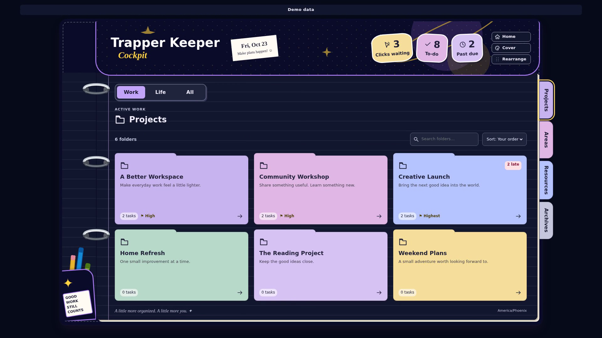

# Short binder demo

[Watch or download the MP4](trapper-keeper-demo.mp4).

**6.467 seconds · 1920 × 1080 · H.264 · 30 fps · silent · 716,387 bytes**

The clip shows the existing binder React interface in a real browser:
Neon Memphis Home → Projects divider → Cover picker → Galaxy → Save cover.
The same component handles navigation, preview and theme changes. This recording
uses fictional records and a fixture adapter that persists to browser storage;
it is not a connected Airtable session or proof of a database write.

The small **Demo data** label stays visible. No personal records, account IDs,
browser address bar, developer controls, live source links or credentials appear.
No audio, AI-generated video or synthetic UI animation is used. The video was
trimmed from a Playwright capture and transcoded to a fast-start MP4.

Recorded sequence:

| Time | State |
| --- | --- |
| 0.0 s | Home with Neon Memphis |
| 1.1 s | Projects divider selected |
| 2.3 s | Cover picker open |
| 3.5 s | Galaxy selected and previewing |
| 4.6–6.5 s | Saved Galaxy Projects view |

The capture reported zero browser errors and zero off-origin requests. The
saved fixture theme was read back as `galaxy`; encoded sample frames were
visually reviewed. MP4 metadata contains only format/encoder information.
[Storyboard](storyboard.png) contains five frames for review.

The public kit is a recipe, not an installer for the app shown in this reference
clip. A user's generated version must still pass the chosen platform's acceptance
checks. Assets are provided for sharing; no social-media post is sent by this kit.
