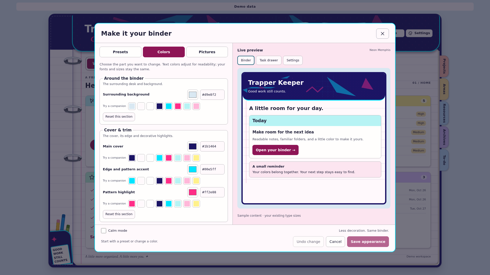
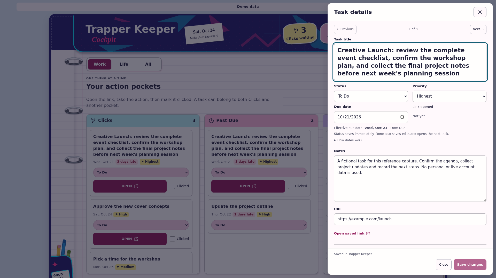

# Short binder demo

[Watch or download the MP4](trapper-keeper-demo.mp4).

**6.5 seconds · 1920 × 1080 · H.264 · 30 fps · silent · 815,703 bytes**

Recorded October 24, 2026 using the current binder React components in a real
remote browser at 100% zoom. Neon Memphis Home → Projects divider → Settings →
Appearance → Galaxy → Save appearance. The new preset-first dialog, compact
binder graphics and preserved reading sizes are part of the actual reference UI.
A small cursor highlight follows actual pointer input; the final view is clear.
No AI-generated video, invented UI transition or visual text blurring is used.

All records belong to a fictional **Alex** demo account. The small **Demo data**
label stays visible. The fixture adapter persists only in browser storage. This
is not a connected Airtable session, a database-write test, or evidence that a
new user's generated app is deployed. No personal records, account identifiers,
browser address bar, developer controls, live source links or credentials appear.

Approximate sequence:

| Time | State |
| --- | --- |
| 0.0 s | Home with Neon Memphis |
| 1.2 s | Projects divider selected |
| 1.8 s | Settings opens |
| 2.4 s | Appearance presets and live preview |
| 3.8 s | Galaxy selected and previewing |
| 5.1–6.5 s | Saved Galaxy Projects view |

Capture checks verify all five theme/dialog/tab states and read the saved
fixture theme back as `galaxy`. Browser errors and off-origin requests are zero.
Encoded frames and MP4 metadata were reviewed; the file contains one H.264 video
stream with no audio and generic format/encoder metadata. The MP4 uses fast start.
See [capture evidence](demo-evidence.json) and the five-frame [storyboard](storyboard.png).

## Additional fictional reference stills

These capture the same current components at 1920×1080. They supplement the
AI-generated concept images with actual reference UI, while keeping backend and
permission validation as requirements for each generated application.

The task title stays 23px and fits fully; Notes and action controls retain their
existing reading sizes. The Appearance sample previews scoped colors and panels.
The clip itself demonstrates tab navigation and the light-to-dark preset change;
it does not demonstrate upload, every color control, every preset, or all modules.

The public kit remains a greenfield, platform-neutral recipe. Assets are provided
for sharing; no LinkedIn or other social-media post is sent by this kit.
