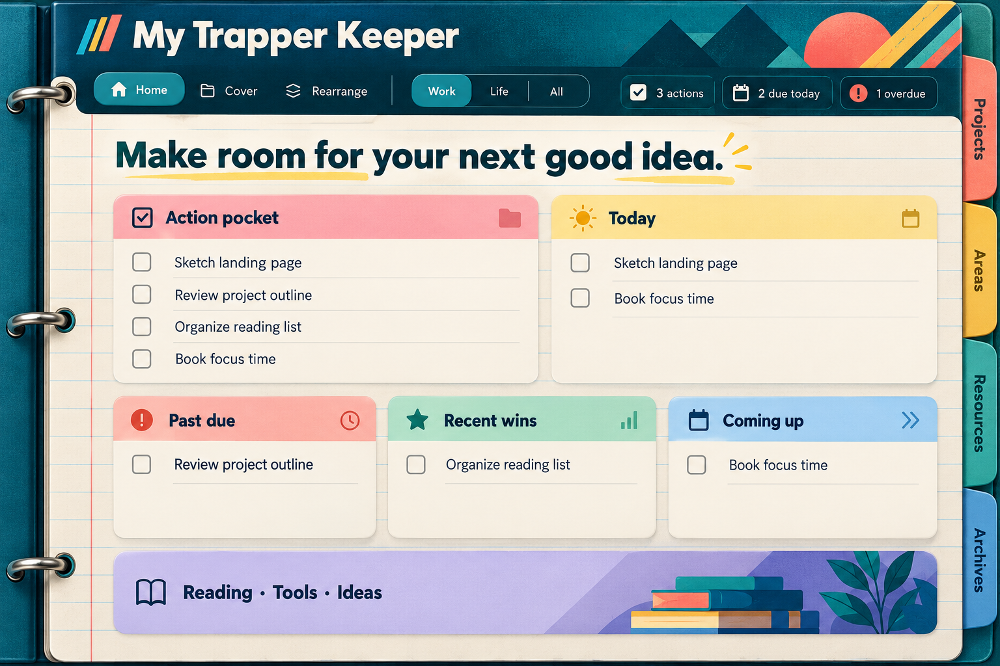
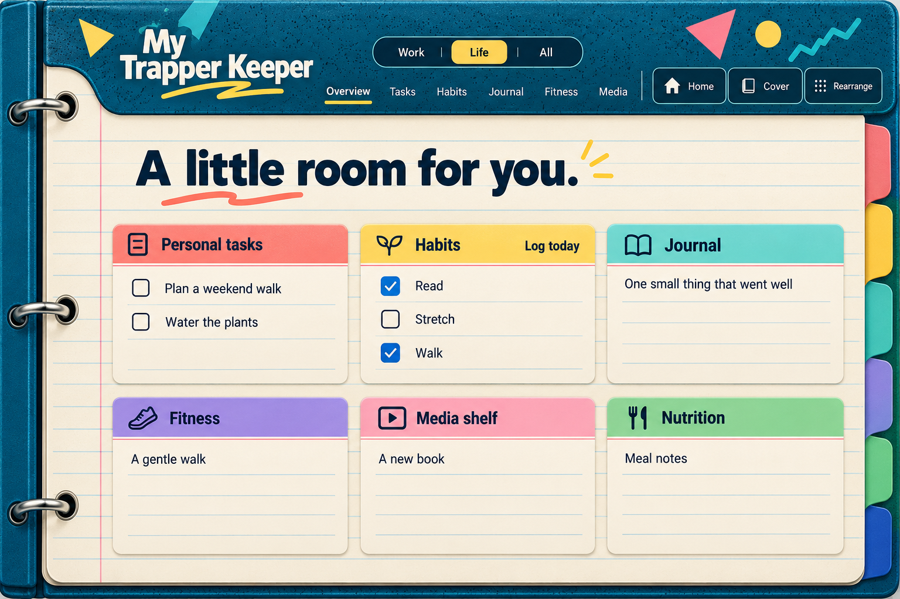
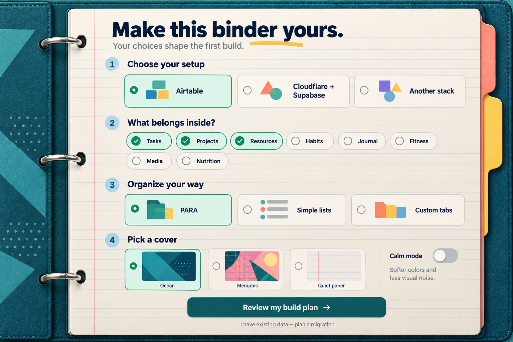

# Visual references

These are original **AI-generated concepts** made with `codex/gpt-5.6-sol` through
an OpenAI-compatible image-generation route. They contain fictional copy and no
account identifiers or live record screenshots. Prompts are included for reuse.
They are visual direction, not proof of a working app or authoritative metric counts.
The user's brief and PRD override concept labels, modules and example totals.

| Concept | Use |
| --- | --- |
| [Work dashboard](work-concept.png) | Daily work pockets, cover, rings, divider hierarchy |
| [Life overview](life-concept.png) | Optional personal modules and dated habit actions |
| [First-run preferences](preferences-concept.png) | Stack choice, modules, organization and appearance |

The preference interview is normally a conversation with the building agent.
The preferences image also illustrates an optional in-app setup screen; that
screen is not a mandatory feature of every generated app.

Review: consistent three-ring binder, readable labels, selected-mode hierarchy,
light paper surface, coherent palette, and no personal content. The concepts are
not pixel-perfect specifications: use semantic tokens, accessible controls, and
real browser validation when implementing. Derive dark themes from the same
system and test their foreground/background pairs.
